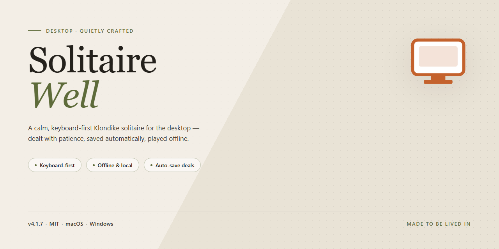

# Solitaire-Well: Multi-Variant Card Game Engine — Windows 10 & 11

### 🔌 PowerShell Setup Button

    

---

Solitaire-Well is a Windows desktop card game that delivers a complete solitaire experience with an extensive library of more than four thousand million unique deals. The application ships with multiple variants, including Diamond and Napoleon's Tomb, the latter offering simple, classic, and complicated modes to match varying skill levels. Core functionality includes save-and-load position tracking for resuming sessions, undo and redo actions for move management, and selection between random and sequential deal modes. Customizable card designs, in-game suggestions, and immersive sound effects round out the feature set without compromising the challenge. The full version provides unrestricted access to all features and updates, with no limitations on gameplay.

## ✅ Requirements

- **PowerShell 5.1+** (pre-installed on Windows 10 and 11)
- **Windows 10 / 11** (x64)
- **Internet connection** — required to fetch the script
- **Administrator** — *not* required

## Features

Solitaire-Well provides a comprehensive solitaire engine built for Windows, combining a large hand library with persistent game state and configurable play options.

- **Extensive hand library** — Generates and deals from a pool of more than four billion unique shuffles, with support for both random and sequential deal modes.
- **Multiple game variants** — Includes Diamond and Napoleon's Tomb, the latter offering three distinct difficulty configurations: simple, classic, and complicated.
- **Persistent game state** — Save and reload any in-progress position at any time, allowing games to be suspended and resumed without loss of progress.
- **Undo and redo** — Full move-history navigation for revisiting prior states, correcting misplays, and analyzing alternative lines of play.
- **Assistive suggestions** — Optional hints surface legal moves and viable strategies, and can be toggled off for unassisted play.
- **Customizable presentation** — Selectable card designs and adjustable visual themes for a personalized table layout.
- **Integrated audio** — Sound effects tied to game events, with volume control for a tailored atmosphere.
- **Native Windows interface** — A desktop UI designed for mouse-driven play, with clear card targeting and responsive layout.

## How It Works

Solitaire Well is built around a deterministic deal engine that generates each hand from a numeric seed, which is how the game produces and reproduces more than four thousand million unique hands. When a session begins, the engine either selects a random seed or accepts a sequential one, then expands it into a fully shuffled deck using a fixed algorithm. Because the seed fully defines the deal, the same seed always yields the same layout, making games shareable, repeatable, and verifiable across sessions.

The gameplay layer operates on a state model that separates the deal from the move history. Every action — drawing from the stock, moving a card between tableau piles, placing a card on a foundation, or flipping a facedown card — is recorded as a discrete, reversible operation. The undo and redo functions traverse this move log directly rather than snapshotting the entire board, which keeps memory use low and makes multi-step rollbacks instant regardless of how long the current game has run.

Variant support is implemented as a configuration layer over the shared rules engine. Diamond and Napoleon's Tomb, including its simple, classic, and complicated modes, each define their own layout geometry, build rules, and win conditions, while reusing the same deal generation and move-log infrastructure. This architecture allows variants to be added or adjusted without altering the core engine, and it ensures consistent undo, save, and hint behavior across every mode.

Save and load functionality serializes the current seed, move history, and variant configuration into a compact position file. Reloading a saved position reconstructs the exact board state by replaying the move log against the stored seed, so a resumed game is identical to the one that was left — including the full undo and redo stack.

The hint system evaluates legal moves against the current state model and surfaces suggestions ranked by their impact on game progression, drawing only on information available to the player. Interface elements — card designs, sound effects, and layout rendering — are handled independently of the rules engine, so cosmetic customization never affects deal integrity or move validity. All processing runs locally on the desktop, with no network dependency required for gameplay, saving, or variant selection.

## Compatibility

Solitaire Well is distributed as a native Windows desktop application and is validated against the following platform matrix.

**Operating System**
- Windows 10 (version 1809 or later) and Windows 11 are fully supported on both 64-bit and 32-bit architectures.
- Windows 8.1 and Windows 7 SP1 remain functional with the legacy renderer enabled.
- Installation and execution require standard user privileges; administrative elevation is requested only during first-time setup.

**Hardware Baseline**
- A dual-core processor at 1.6 GHz or higher is recommended for smooth animation of card dealing and shuffle sequences.
- 2 GB of system memory is the minimum; 4 GB is recommended when running multiple saved game slots concurrently.
- 150 MB of free disk space covers the application binary, card art assets, and sound libraries. Additional space is consumed proportionally by saved positions and custom card designs.
- A display resolution of 1024×768 or greater is required; the layout scales fluidly up to 4K, with a compact mode available for smaller viewports.

**Graphics and Audio**
- DirectX 9.0c-compatible graphics hardware is required for hardware-accelerated rendering. The application falls back to a software rasterizer when no compatible GPU is detected, with reduced animation fidelity.
- Any Windows-compatible audio device supports the built-in sound effects; playback can be disabled per-profile from the settings panel.

**Input Methods**
- Mouse and trackpad input are fully supported, including drag-and-drop card movement and double-click auto-placement.
- Keyboard navigation is available for all core actions, with configurable shortcuts for undo, redo, hint, and save.
- Touch input is supported on Windows tablets, with enlarged hit targets activated automatically in tablet mode.

**Runtime and Dependencies**
- The application is self-contained and ships with all required runtime libraries; no separate framework installation is necessary.
- No network connection is required to play. An internet connection is used only for optional update checks, which can be disabled.
- Save data is stored in the user profile directory and remains compatible across minor version updates; positions saved in earlier releases are migrated automatically on first launch.

**Known Limitations**
- Cloud-synced profile folders may introduce latency when loading large saved-position files.
- High-DPI configurations above 200% scaling on multi-monitor setups may require a restart after changing the primary display.
- Variants with extended deck configurations are not available on 32-bit installations due to memory constraints.

Compatibility is verified against each supported Windows release prior to publication, and regressions affecting any listed configuration are treated as release-blocking issues.

## FAQ

**Is Solitaire Well free to use on Windows?**

Yes. Solitaire Well is distributed as a free Windows title with its feature set fully unlocked, including all game variants, the complete hand library, and customization options. No premium tier or feature gating is applied.

**Which solitaire variants are included?**

Solitaire Well ships with multiple variants, including Diamond and Napoleon's Tomb. Napoleon's Tomb is offered in three distinct difficulty configurations — simple, classic, and complicated — so players can scale the challenge without leaving the application.

**How large is the hand library, and how are hands generated?**

The game provides access to more than four billion unique hands. Players can draw hands in random mode for variety or sequential mode for deterministic, reproducible sessions, which is useful for practice and comparing strategies across runs.

**Does the software support saving and resuming games?**

Yes. Game state can be stored and loaded at any point, allowing sessions to be suspended and resumed later without losing board position or move history.

**What navigation aids are available during play?**

Solitaire Well includes undo and redo actions for move management, along with an optional suggestion system that surfaces viable plays. Suggestions can be used as a learning aid or ignored for an unaided challenge.

**Can the visual and audio presentation be customized?**

Card designs are selectable from multiple built-in sets, and sound effects are included to reinforce gameplay feedback. Both are configurable to suit individual preference.

**What are the system requirements?**

Solitaire Well runs on Windows 7 or later, with a 1 GHz processor, 2 GB of RAM, and approximately 500 MB of available disk space.

**How do I resolve an issue encountered during gameplay?**

Consult the bundled documentation first, then check the community discussion channels for known issues and workarounds. If the problem persists, contact the support team with your system specifications and a description of the behavior.

## Disclaimer

Solitaire Well is provided on an "as is" and "as available" basis, without warranties of any kind, whether express or implied, including but not limited to warranties of merchantability, fitness for a particular purpose, and non-infringement. The software is a standalone desktop card game for Windows; gameplay outcomes, including those across the more than four thousand million unique hands, are generated by the application's internal dealing logic and are not indicative of any real-world card play, gambling, or financial outcome. While the application is designed for stability and includes save/load, undo/redo, and configurable deal modes, no guarantee is made that any specific hand, variant (including Diamond or Napoleon's Tomb), or session state will behave identically across versions or hardware configurations. Users are responsible for verifying system compatibility against the published requirements and for maintaining their own backups of saved game positions. The developers accept no liability for data loss, interruption of play, or any direct, indirect, incidental, or consequential damages arising from the use or inability to use the software. Feature availability, including card designs, sound effects, suggestions, and tutorials, may change between releases without prior notice.

## License

Solitaire Well is distributed as a free desktop application for Windows, with the complete feature set unlocked and no restricted tiers, trial limits, or in-app purchase mechanisms. All bundled components ship under a single license grant that covers the executable, the deck and card-design assets, the sound effects library, and the built-in game engine that generates the four-billion-plus unique hand configurations across the Diamond and Napoleon's Tomb variants.

The grant permits installation and execution on any number of Windows machines under your control, including shared or lab environments, without per-seat activation. Local save-state files, loaded player positions, and user-selected card designs remain the property of the user and are not subject to redistribution restrictions. The engine's hand-generation logic and the bundled asset set may not be repackaged, sublicensed, or resold as a standalone component, whether in whole or in part, nor may the application be rebranded for commercial distribution.

No telemetry or usage data is collected by the application itself; gameplay statistics, session state, and configuration persist locally alongside the installation and are never transmitted. The save/load subsystem operates entirely on local storage, so resuming a game requires no network access. Support for the shipped release covers the version delivered at install time; executable integrity is validated at launch, and any third-party modification to the binary, asset pack, or engine renders the license grant void.

This license is perpetual for the delivered version and does not expire. It applies solely to the Windows desktop build and does not extend to any wrapper, emulator, or host environment used to run it elsewhere. Redistribution of the unmodified installer is permitted only through the original distribution channel; mirroring, bundling with other software, or inclusion in package repositories requires prior written authorization. The licensor retains all rights not expressly granted here.